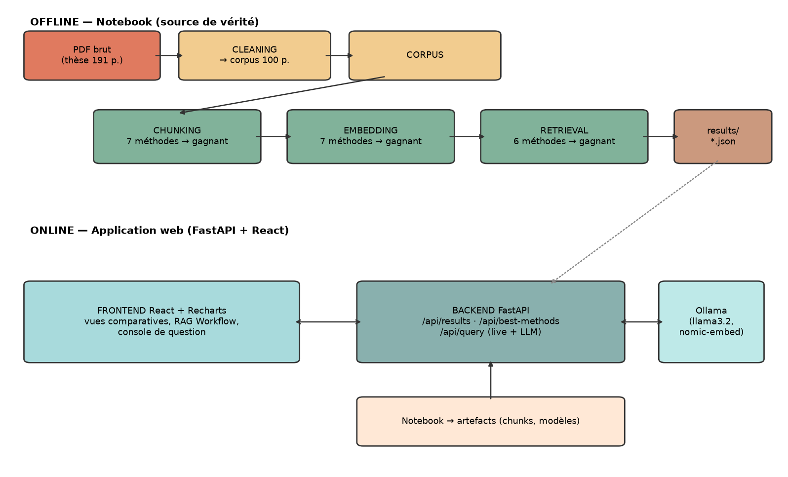

# RAG Lab 🧪

[](LICENSE)
[](https://www.python.org)
[](https://fastapi.tiangolo.com)
[](https://vite.dev)
[](https://ollama.com)

Projet de fin d'année (PFA) — **pipeline RAG complet avec comparaison chiffrée des méthodes à chaque étape**, sur un corpus réel (thèse académique nettoyée de 191 à 100 pages), plus une **application web** pour la soutenance.

> **Question de recherche** : à chaque étape d'un pipeline RAG (découpage, vectorisation, recherche), quelle méthode est la meilleure et pourquoi ? Réponse apportée par des comparaisons chiffrées sur un corpus réel, puis démontrée dans une application web.

| Étape | Méthodes comparées | Métriques |
|---|---|---|
| Nettoyage (notebook) | — (191 → 100 pages, consignes encadrante) | pages retirées, mots, caractères |
| Découpage (chunking) | 7 (taille fixe, récursif, phrase, paragraphe, fenêtre, tokens, sémantique) | 9 (intra/inter, Recall@2, F1, MRR…) |
| Vectorisation (embedding) | 7 (Word2Vec, GloVe, FastText, BERT, SBERT, Doc2Vec, Ollama) | 8 (Precision@2, MAP, MRR, nDCG…) |
| Recherche (retrieval) | 6 (brute, FAISS ANN, BM25, DPR, hybride RRF, re-ranking) | P@5, R@5, MRR, MAP@5, nDCG@5, cosine sim., latence |
| Génération (LLM) | Ollama (repli Hugging Face) + benchmark 1B/3B/8B | latence, ms/token, citations |

**Pipeline gagnant** (voir `results/best_methods.json`) : chunking **sémantique** (MRR 0.969, 229 chunks) → vectorisation **Sentence-BERT** (`all-MiniLM-L6-v2`, nDCG 0.976) → recherche **BM25** (1 ms/requête, nDCG@5 0.725) → génération **Ollama llama3.2:1b** (2,6 citations/réponse).

## 💭 Pourquoi ce projet

Le sujet m'a été proposé pendant mon stage d'été de 4ᵉ année IIR, encadré par Dr. EL MKHALET MOUNA : partir **d'un vrai corpus** (une thèse académique sur les bassins versants et les nitrates) plutôt que d'un dataset d'exemple.

Là où la plupart des projets RAG implémentent "un" pipeline, l'objectif ici était de **ne rien choisir au hasard** : chaque étape (découpage, vectorisation, recherche) a été traitée comme une question expérimentale, avec plusieurs méthodes candidates et des métriques reproductibles mesurées sur le même corpus — puis les gagnants sont assemblés dans le pipeline final et servis par l'application web.

Ce que je retire du projet : une intuition se vérifie mal sur un seul cas (la sémantique "devait" gagner en retrieval, c'est BM25 qui a gagné sur mes questions de test), et des chiffres publiés sans méthode de mesure ne valent pas grand-chose — d'où les `results/*.json` qui alimentent à la fois le mémoire et l'app.

## 📁 Structure

```
├── PROJET_RAG_COMPLET.ipynb     # Source de vérité : cleaning → 3 comparaisons → génération → exports
│   (une version consultable sans Jupyter est fournie : PROJET_RAG_COMPLET.html)
├── thèse_pdf.pdf                # Corpus brut fourni (thèse académique)
├── data/                        # Corpus nettoyé (produit par le notebook)
├── results/                     # JSON + artefacts produits par le notebook, consommés par l'API
├── docs/                          # Figures du projet générées par le notebook → docs/README.md
├── backend/                     # API FastAPI : /api/results, /api/best-methods, /api/query (+ tests pytest)
└── frontend/                    # React + Vite + Recharts (build servi par FastAPI)
```

## 🚀 Démarrage rapide

**Prérequis** : Python 3.13+ ([uv](https://docs.astral.sh/uv/) recommandé), Node.js 20+, [Ollama](https://ollama.com) (facultatif mais recommandé).

```bash
# 0. Modèles locaux Ollama (embeddings + LLM)
ollama pull nomic-embed-text && ollama pull llama3.2:1b

# 1. Environnement Python
uv venv .venv --python 3.13
uv pip install -p .venv -r requirements.txt

# 2. Notebook (source de vérité) — produit data/ et results/
jupyter nbconvert --to notebook --execute --inplace PROJET_RAG_COMPLET.ipynb

# 3. Frontend
cd frontend && npm install && npm run build && cd ..

# 4. Application complète (un seul port)
python -m uvicorn backend.main:app --port 8001
```

➡️ Ouvrir **http://localhost:8001** — l'API est exposée sur `/docs` (ex. `/api/results/chunking`).

Ollama absent ? Le notebook et le backend replient automatiquement vers un modèle Hugging Face.

## 🏗️ Architecture



- Les **comparaisons ne sont jamais recalculées** en live : l'API sert les fichiers `results/*.json` produits par le notebook, et un moteur live (chunks + embeddings + BM25 du gagnant) pour la console de question.
- Chaque étape du notebook exporte ses mesures en JSON → l'application affiche les mêmes chiffres que le mémoire.

## 📚 Figures

Les images comparatives générées par le notebook (architecture, chunking, embedding, retrieval) sont dans [docs/](docs) — index : [docs/README.md](docs/README.md).

## ✅ Tests

```bash
pytest backend/tests -v
```

## 📄 Licences & corpus

Code sous licence [MIT](LICENSE). La thèse (`thèse_pdf.pdf`) est le corpus d'étude fourni dans le cadre du stage : elle reste la propriété de son auteur et est hébergée uniquement pour la reproducibilité du projet.

---

*Projet réalisé par **Aymen Ichqarrane** dans le cadre d'une PFA (stage d'été, 4ᵉ année IIR), encadrée par Dr. EL MKHALET MOUNA.*
